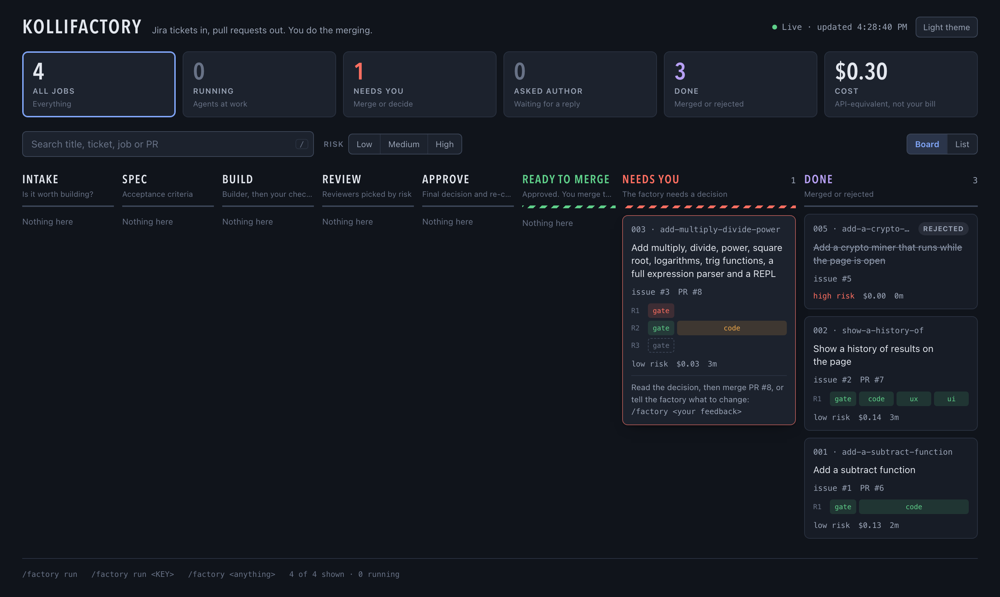
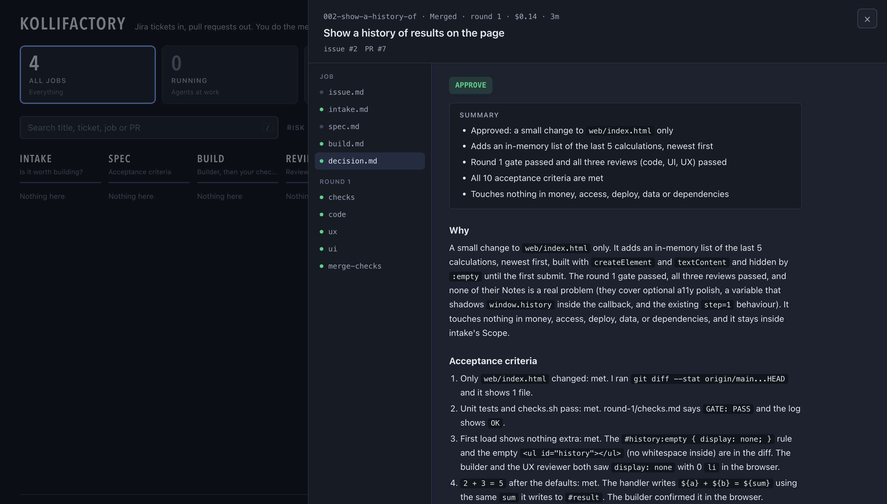
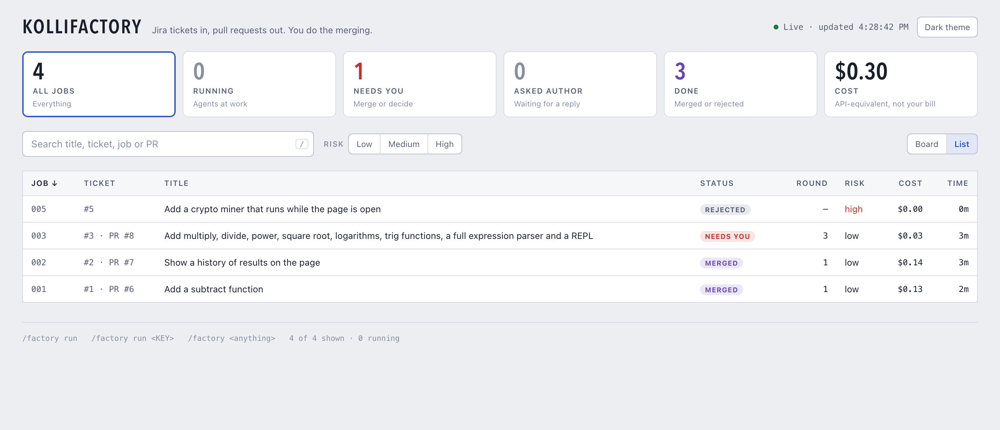

# Kollifactory

**Jira tickets in, pull requests out. You do the merging.**

Kollifactory is an open-source software factory for Claude Code. Label a Jira
ticket `kollifactory`, run `/kollifactory run`, and a team of agents decides
whether it's worth building, writes a spec, builds it, tests it with your own
checks, reviews it, and opens a GitHub pull request. The factory never merges:
an approved PR is marked ready, and you merge it.



It works on any project Claude Code can open, in any language. Your own test,
lint and build commands are the gate, so the factory holds its work to the same
bar as yours.

**Contents:** [What you need](#what-you-need) · [Install](#install) ·
[The loop](#the-loop) · [Local or remote](#local-or-remote) ·
[Commands](#commands) · [Dashboard](#dashboard) ·
[The example jobs](#the-example-jobs) · [Cost and safety](#cost-and-safety) ·
[Contributing](#contributing)

## What you need

| | |
|---|---|
| **Claude Code** | 2.1.257 or later |
| **python3** | runs the factory scripts and serves the dashboard |
| **Jira** | an API token for the site your tickets live on |
| **GitHub** | an authenticated [`gh`](https://cli.github.com/) that can push to the repo. Not needed in [local mode](#local-or-remote). |

No Jira yet? You can still look around: copy `examples/jobs/` to
`factory/jobs/` and open the [dashboard](#dashboard).

## Install

Open Claude Code in your project and paste:

```text
Install Kollifactory in this project. Follow
https://raw.githubusercontent.com/jabbourdan/kollifactory/main/INSTALL.md
from start to finish: copy the files, then set it up with me step by step
(local or remote, .env, Jira, checks, app preview), then run the check and tell
me what is left before I can run /kollifactory run.
```

Your agent reads [`INSTALL.md`](INSTALL.md), copies the skill, agents, scripts
and dashboard, fills `factory/checks.sh` with your project's real test, lint,
typecheck and build commands, tailors the reviewers to your stack, and checks
that `checks.sh` passes on `main`.

For Jira, set `JIRA_EMAIL` and `JIRA_API_TOKEN` (or `JIRA_TOKEN`) in your
environment, in a gitignored `.env` at the repo root (start from
[`.env.example`](.env.example)), or in `~/.jira-token`, and set `jira.base_url`
in `factory/config.json`. The installer walks you through this, and
`/check-kollifactory` tells you what is still missing.

## The loop

```
Jira tickets labeled `kollifactory`
        │
        ▼
intake (fable) ── NEEDS-INFO → asks the author on the ticket, waits for a reply
        │         REJECT     → says why on the ticket, removes the label
        ▼ ACCEPT, maybe rescoped; rates risk + surfaces; ticket → In Progress
route (script)    picks reviewers and models from config.json
        ▼
spec-writer (opus) → spec.md
        ▼
builder (opus) → commits, pushes, opens a draft PR "<KEY>: <title>"
        ▼            ▲
gate (script) ─FAIL──┤  factory/checks.sh; no reviewer runs on a failing build
        ▼ PASS       │
reviewers ─CHANGES───┘  code (haiku | sonnet), + ux & ui on UI changes, + security
        ▼ all PASS
approver (opus) ── APPROVE  → sync with main, gate again, PR marked ready; you merge it
                └─ ESCALATE → PR ready for you, ticket labeled kollifactory-needs-human
```

One Claude Code session orchestrates every job, `concurrency` at a time
(default 3). Each job gets its own git worktree and branch. All state lives in
`factory/jobs/`, so if the session dies, `/kollifactory run` picks every job back up.

## Local or remote

Set `"mode"` in `factory/config.json`, or pick per ticket with
`/kollifactory run <KEY> local` (or `remote`):

- **remote** (default): the branch is pushed and a GitHub PR is opened. When
  approved, the PR is marked ready and you merge it on GitHub.
- **local**: nothing is pushed and there is no PR. When approved, the branch
  `factory/<job-id>` is ready on your machine and you merge it with `git merge`.
  Local mode needs no GitHub remote.

Either way each job is a full copy of the project in `.worktrees/<job-id>`,
which you can open and run. When a job is ready, the factory starts the app
from that folder: set `preview.command` in `factory/config.json` (for example
`npm run dev -- --port {port}`) and, if a fresh folder needs it,
`preview.setup` (for example `npm ci`). The dashboard shows the folder and a
link to the running app. `factory/bin/job preview <job> start|stop` runs or
stops it by hand.

## Commands

```
/init-kollifactory          guided setup: local or remote, .env, Jira, checks, app preview
/check-kollifactory         is everything configured? says what to fix (read-only)
/kollifactory run           build every open `kollifactory` ticket, `concurrency` at a time; also resumes
/kollifactory run <KEY>     one Jira ticket now (e.g. WBI-12); add `local` or `remote` to pick the mode
/kollifactory <anything>    talk to the factory: ask about jobs, give feedback, file a feature
```

You approve by merging the PR on GitHub; the Jira ticket stays In Progress
until you move it. To change a ready or escalated PR, tell the
factory what you want with `/kollifactory`. To drop a job that waits on you or on
its author, tell the factory to reject it.

## What's in here

```
.claude/
  skills/factory/SKILL.md     the orchestrator: queue, concurrency, the pipeline
  agents/
    intake.md                 fable    worth building? at what scope? risk + surfaces
    spec-writer.md            opus     spec.md
    builder.md                opus     code, commits, the PR, build.md
    reviewer-code.md          routed   correctness, simplicity, tests
    reviewer-security.md      opus     only when intake flags `security`
    reviewer-ux.md            sonnet   only when intake flags `ui`
    reviewer-ui.md            haiku    only when intake flags `ui`
    approver.md               opus     APPROVE or ESCALATE
factory/
  config.json                 concurrency, rounds, labels, routing, protected paths, prices
  checks.sh                   your repo's checks (the installer fills it in)
  bin/job                     the only writer of job.json; refuses illegal moves; talks to Jira
  bin/gate                    runs checks.sh in a job's worktree → round-N/checks.md
  bin/route                   risk + surfaces → the job's reviewers and models
  dashboard.html              the board
examples/jobs/                finished jobs from a real run
docs/images/                  the screenshots in this README
INSTALL.md                    instructions for the installing agent
DESIGN.md                     how it works and why
```

[`DESIGN.md`](DESIGN.md) explains each decision.

## Dashboard

```bash
cd factory && python3 -m http.server 8765
```

Open <http://localhost:8765/dashboard.html>. Each job is a card with its ticket
and PR, a row of gate and review chips per round, its risk, cost and
time. To see the example jobs, copy `examples/jobs/` to `factory/jobs/` first.

Click a card to read every file the job wrote. Each one opens with a short
summary of what happened in that step:



There is also a sortable list view and a light theme:



Cost is the API-equivalent price of each job's agents, read from Claude Code's
transcripts. On a subscription plan it shows where the spend goes, not what
you're billed.

## The example jobs

They come from a test run on a small private calculator repo, with
`concurrency: 2` and every agent on Haiku to keep it cheap.

- **001-add-a-subtract-function**: low risk, no UI, so only the code reviewer
  ran. Approved and merged through its PR.
- **002-show-a-history-of**: a UI change, so the UX and UI reviewers ran too.
  Merged.
- **003-add-multiply-divide-power**: intake cut an oversized "scientific
  calculator" issue down to three functions. The gate failed round 1 because
  the builder edited a protected test file, and the job went to a human after
  three rounds.
- **005-add-a-crypto-miner**: rejected at intake.

## Cost and safety

- It opens real PRs (it never merges them) and runs on your Claude plan. Start with
  `concurrency: 1` and read every PR until you trust it.
- Intake runs on Fable once per ticket. Depending on your plan, Fable can bill
  to usage credits rather than your plan's included usage.
- Only Jira tickets labeled `kollifactory` run. Ticket text reaches the agents
  as quoted data, never as their instructions.
- The factory pushes only `factory/*` branches, never merges, and never deploys.

## Contributing

Contributions are welcome, from a typo fix to a new reviewer.

- **Found a bug or have an idea?** Open an
  [issue](https://github.com/jabbourdan/kollifactory/issues). For a bug, say
  what you ran, what you expected and what happened; the job's folder in
  `factory/jobs/` usually holds the answer.
- **Want to change something?** Fork the repo, make your change on a branch and
  open a pull request. Small, focused PRs are the easiest to review.
- **Not sure where to start?** [`DESIGN.md`](DESIGN.md) explains how the pieces
  fit and why. The agents are plain Markdown files in `.claude/agents/`, so
  changing how one behaves is a matter of editing its prompt.
- **Stuck on setup?** Run `/check-kollifactory` and include its output in your
  issue.

